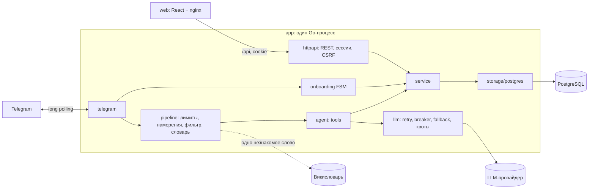

# ИИ-бот учёта семейных расходов

Telegram-бот, который понимает траты обычными словами («кофе 350», «поход в рестик 7698 вчера»,
«последнее было не 350, а 450»), и веб-панель для главы семьи. Несколько семей: семью можно создать или
вступить в неё по ссылке-приглашению. Бэкенд на Go (один бинарник), PostgreSQL, панель на React,
всё поднимается одним `docker compose`.

- Спецификация и план: [docs/architecture.md](docs/architecture.md)
- Контракт REST API: [api/openapi.yaml](api/openapi.yaml)
- Правила для ИИ-ассистентов и структура кода: [AGENTS.md](AGENTS.md)

## Запуск за 5 минут

Нужен только Docker (Go и Node на машине не нужны).

1. **Токен бота.** В Telegram откройте [@BotFather](https://t.me/BotFather) → `/newbot` → скопируйте токен.
   Рекомендуется там же: `/setjoingroups` → Disable (бот работает только в личных чатах).
2. **Ключ LLM.** Подойдёт любой OpenAI-совместимый провайдер, см. [таблицу ниже](#llm-какой-провайдер-взять).
   Проверенный вариант: ключ [Google AI Studio](https://aistudio.google.com/apikey).
3. **Конфиг.**
   ```bash
   cp .env.example .env
   ```
   Заполните `TELEGRAM_BOT_TOKEN`, `LLM_BASE_URL`, `LLM_API_KEY`, `LLM_MODEL` (и `LLM_REASONING_EFFORT` для
   «думающих» моделей). Остальное можно не трогать.
4. **Старт.**
   ```bash
   docker compose up --build
   ```
   Миграции БД применятся сами. Готовность: `curl localhost:8080/readyz` → `{"status":"ok"}`.
5. **Проверка.** Напишите боту `/start` → «Создать семью» → название → город. Затем `кофе 350`.
   Панель: напишите боту `панель` и откройте ссылку (по умолчанию она ведёт на http://localhost:3000).

Если порт 5432, 3000 или 8080 занят, поменяйте `DB_HOST_PORT`, `WEB_PORT`, `APP_PORT` в `.env`.

### Режим в точности по заданию

В задании сказано, что авторизация панели не нужна. Из-за нескольких семей без авторизации панель показывала бы
чужие данные, поэтому по умолчанию вход идёт по одноразовой ссылке из бота. Режим без авторизации включается
конфигом:

| `PANEL_AUTH_MODE` | Поведение |
|---|---|
| `magic_link` (по умолчанию) | Глава семьи пишет боту «панель» и получает одноразовую ссылку (10 минут). Сессия в HttpOnly cookie, CSRF-токен, проверка Origin |
| `none` | Без входа: панель работает от имени главы семьи `PANEL_FAMILY_ID` (или единственной семьи). Только для локального демо |

### Профили compose

| Команда | Что поднимается |
|---|---|
| `docker compose up --build` | `db`, `app` (API + бот), `web` (панель на nginx) |
| `docker compose --profile prod up -d --build` (`make prod`) | плюс `caddy` (HTTPS по Let's Encrypt для `DOMAIN`) и `backup` (ежедневный `pg_dump` в `./backups`, 14 дней) |
| `docker compose --profile local up -d --build` | плюс `ollama` для локальной модели без ключей, см. комментарий в compose |

Для `prod` в `.env` нужны `DOMAIN=bot.example.com` и `PUBLIC_URL=https://bot.example.com`, DNS-запись на сервер
и открытые порты 80/443. Восстановление бэкапа:
`gunzip -c backups/expenses-<дата>.sql.gz | docker compose exec -T db psql -U app -d expenses`.

## Деплой на Render (бесплатно)

В репозитории есть [render.yaml](render.yaml): Render по нему сам создаёт сервис и БД. Всё работает в одном
контейнере ([deploy/single.Dockerfile](deploy/single.Dockerfile)): API, бот и панель.

Особенности бесплатного тарифа Render, под которые настроен деплой:

- **Сервис засыпает через 15 минут без входящих запросов.** Поэтому бот работает через webhook
  (`TELEGRAM_MODE=webhook`): сообщение из Telegram будит сервис. Первое сообщение после простоя обрабатывается
  примерно через минуту — Telegram сам повторяет доставку.
- **Бесплатная БД Render удаляется через 30 дней** (плюс 14 дней на апгрейд). Для постоянной работы укажите в
  `DB_DSN` внешний бесплатный Postgres, например [Neon](https://neon.tech), со `?sslmode=require`.
- 750 бесплатных часов в месяц на аккаунт — одному сервису хватает.

Шаги:

1. Если уже создан сервис с runtime Go, удалите его: runtime сервиса нельзя сменить на Docker.
2. Render → **New → Blueprint** → выберите репозиторий и ветку.
3. Введите секреты, которые спросит Render: `TELEGRAM_BOT_TOKEN`, `LLM_API_KEY`, `LLM_FALLBACK_API_KEY`.
4. Дождитесь деплоя и проверьте `https://<сервис>.onrender.com/healthz`. Бот сам зарегистрирует webhook на этот адрес.
5. **Остановите локальный бот** (`docker compose stop app`): webhook и long polling с одним токеном не работают
   одновременно. Если позже запустить локально в режиме polling, сервер не станет снимать чужой webhook и
   остановится с понятной ошибкой.
6. Напишите боту `панель`: ссылка будет вести на адрес Render (`PUBLIC_URL` берётся из `RENDER_EXTERNAL_URL`).

`/metrics` в этом режиме закрыт токеном: `Authorization: Bearer <METRICS_TOKEN из дашборда>`.

## Как это устроено



Путь сообщения в боте. LLM вызывается только в самом конце и только когда без неё не обойтись:

| Шаг | Что делает | Стоимость |
|---|---|---|
| Технические проверки | только личные чаты, текст, длина до `MAX_MESSAGE_LEN`, дедупликация по `update_id` | 0 токенов |
| Лимиты | `RATE_LIMIT_PER_MIN` на пользователя, суточные квоты LLM на пользователя, семью и всех | 0 токенов |
| Онбординг | пока регистрация не завершена, сообщения в LLM не уходят | 0 токенов |
| Служебные команды | «помощь», «ссылка», «панель», «мой часовой пояс …», «выйти из семьи», «удалить мои данные» | 0 токенов |
| Фильтр правил | стоп-слова и запрещённые темы («сделай домашку», «какая ты модель», «игнорируй инструкции») → шаблонный отказ; разбор суммы («1 200 р», «1.5к», «2 тыс») и даты («вчера», «в пятницу», «5 марта») | 0 токенов |
| Категория | словарь [config/synonyms.yaml](config/synonyms.yaml) (~250 терминов, ~930 форм, стеммер Портера, уменьшительные формы) → кэш выученных слов в БД → голосование гиперонимов и синонимов из [Викисловаря](https://ru.wiktionary.org) | 0 токенов |
| Простая трата | сумма и категория распознаны → запись сразу («кофе 350», «я потратил вчера 550 на шавуху») | 0 токенов |
| Агент | запросы, изменения, удаление, несколько трат, незнакомые слова → один запрос с `tool_choice=required` | ~1 200 токенов на входе, 10–60 на выходе |

Агент устроен так, чтобы модель не могла навредить:

- модель только выбирает инструмент и аргументы, текст ответа формирует Go по шаблонам из фактического результата
  в БД (модель не может написать «готово», если ничего не записано);
- сумма от модели принимается, только если Go сам нашёл её в тексте сообщения;
- модель не видит идентификаторов: «последняя трата» и «удали такси» разрешаются в Go и только среди трат
  самого пользователя; при нескольких совпадениях бот показывает список и ждёт номер;
- после ответа LLM незнакомое слово запоминается, и в следующий раз обходится без неё;
- если LLM недоступна, простая трата всё равно записывается (в «другое»), остальное получает понятный ответ.

Данные: деньги хранятся в копейках (`BIGINT`), в API передаются строкой `"350.00"`. Дата траты — календарная
дата в часовом поясе пользователя (город, «МСК+2», «UTC+5» или геолокация). Каждый запрос к данным фильтруется
по `family_id`, а для бота ещё и по `user_id`. Параллельные правки из бота и панели разрешаются оптимистичной
блокировкой: при конфликте панель получает 409 и показывает понятное сообщение.

## Веб-панель

Обзор трат за период: итоги, графики по категориям, дням и людям, фильтры (член семьи, период, категории,
поиск с синонимами), добавление, правка и удаление трат, участники (подписи, удаление, передача главенства),
приглашения (скопировать ссылку или код, отозвать), настройки семьи. Тема: светлая, тёмная или авто по часам
устройства (по умолчанию тёмная с 18:00 до 08:00, часы настраиваются). Адаптирована для телефона.

Разработка с горячей перезагрузкой (API должен работать на :8080):

```bash
docker run --rm -it -p 3000:3000 -e API_URL=http://host.docker.internal:8080 -v "$PWD/web":/app -w /app node:22-alpine sh -c "npm ci && npx vite --host 0.0.0.0"
```

## Конфигурация

Всё задаётся в `.env`, полный список с комментариями — в [.env.example](.env.example). Конфиг проверяется при
старте, и при ошибке сервер не запускается и пишет понятное сообщение.

| Переменная | Зачем |
|---|---|
| `TELEGRAM_BOT_TOKEN` | токен от @BotFather (обязательно) |
| `TELEGRAM_MODE` | `polling` (по умолчанию) или `webhook` для хостингов, которые усыпляют сервис; webhook требует https `PUBLIC_URL` |
| `WEB_DIR` | путь к собранной панели — тогда Go раздаёт её сам (один контейнер) |
| `METRICS_TOKEN` | Bearer-токен для `/metrics`; без него в режиме одного контейнера `/metrics` не публикуется |
| `ALLOWED_TELEGRAM_IDS` | список ID через запятую — закрытая регистрация; пусто — открыта всем |
| `LLM_BASE_URL`, `LLM_API_KEY`, `LLM_MODEL` | основной провайдер (обязательно) |
| `LLM_REASONING_EFFORT` | `none`/`minimal`/`low` для «думающих» моделей, иначе они тратят лимит токенов на размышления |
| `LLM_FALLBACK_*` | запасной провайдер, переключение автоматическое |
| `AGENT_MODE` | `tools` (function calling) или `json` для моделей без инструментов |
| `LLM_DAILY_QUOTA_USER/FAMILY/GLOBAL` | суточные лимиты запросов к LLM |
| `PUBLIC_URL` | адрес панели для ссылок входа |
| `THESAURUS_ENABLED` | онлайн-тезаурус для незнакомых слов (наружу уходит одно слово) |
| `APP_TZ` | часовой пояс по умолчанию для новых семей |

## LLM: какой провайдер взять

Проверено 16.10.2026. Условия бесплатных тарифов меняются без предупреждения, сверяйтесь с сайтами провайдеров.

| Провайдер | `LLM_BASE_URL` | Модель | Заметки |
|---|---|---|---|
| Google Gemini | `https://generativelanguage.googleapis.com/v1beta/openai` | `gemini-3.5-flash` + `LLM_REASONING_EFFORT=none` | проверено; запасной — `gemini-flash-lite-latest` (без reasoning effort). Бывают 503 при нагрузке, их закрывают ретраи и fallback. Из РФ недоступен без обходных путей |
| OpenAI | `https://api.openai.com/v1` | `gpt-4.1-mini` | платно; для gpt-5 и o-серии клиент сам шлёт `max_completion_tokens` |
| OpenRouter | `https://openrouter.ai/api/v1` | `openrouter/free` | бесплатно 50 запросов в день — только для пробы |
| Ollama (локально) | `http://ollama:11434/v1` | `qwen2.5:7b` | профиль `local`, без ключа; на слабых моделях может понадобиться `AGENT_MODE=json` |

Ограничения, о которых нужно знать:

- бесплатные лимиты рассчитаны на прототипы; для открытого бота с несколькими семьями нужен платный тариф,
  поэтому квоты на пользователя и семью включены по умолчанию;
- в LLM уходит только текст сообщения о трате, без имён и идентификаторов; провайдеры бесплатных тарифов
  (например, Gemini free) вправе использовать запросы для обучения;
- из России официально недоступны Gemini, OpenAI и Claude; если провайдер недоступен, бот продолжает записывать
  простые траты без LLM.

## Безопасность

- Ссылка входа одноразовая, живёт 10 минут; в БД хранятся только SHA-256 токенов и сессий; токен меняется на
  сессию POST-запросом со страницы, чтобы превью ссылок в Telegram не могло его использовать.
- Без HTTPS (`Secure`-cookie) панель годится только для локальной сети; для доступа извне используйте профиль
  `prod` с Caddy.
- Коды приглашений: 10 символов Crockford base32 (50 бит), не больше 5 неудачных попыток в час, одинаковый ответ
  на неверный, истёкший и отозванный код.
- Тексты сообщений и коды не пишутся в логи, токен бота не попадает в тексты ошибок.
- `.env` с ключами в `.gitignore`. Если ключи куда-то попадали (чат, скриншот), перевыпустите их.

## Допущения

- Только личные чаты с ботом; группы и каналы игнорируются.
- Одна валюта — рубли.
- Пользователь состоит максимум в одной семье. При выходе его траты остаются в семье; «удалить мои данные»
  удаляет их полностью. Последний участник, выходя, удаляет семью целиком.
- Удаление физическое, без корзины.
- Бот работает строго в одной реплике (long polling). Для масштабирования нужен переход на webhook.

## Разработка

```bash
make run      # Postgres в Docker, сервер через go run
make test     # go test -race ./...
make lint     # golangci-lint в Docker (.golangci.yml)
make fuzz     # фаззинг парсера сумм и фильтра
make logs     # логи app и web
make metrics  # метрики Prometheus
```

CI ([.github/workflows/ci.yml](.github/workflows/ci.yml)): линтер, тесты с `-race` на сервисном Postgres и
короткий фаззинг, сборка панели, сборка обоих Docker-образов.

### Метрики и наблюдаемость

`GET /metrics` на порту приложения отдаёт метрики в формате Prometheus. Наружу они не публикуются: nginx
проксирует только `/api/`, а порт приложения в compose слушает 127.0.0.1.

| Метрика | Что показывает |
|---|---|
| `llm_requests_total{provider,result}`, `llm_request_duration_seconds`, `llm_tokens_total{provider,kind}` | нагрузку и стоимость LLM, сбои провайдеров |
| `filter_decisions_total{verdict,reason}` | сколько сообщений обработано без LLM, а сколько ушло в модель |
| `category_source_total{source}` | откуда берутся категории: словарь, кэш, Викисловарь, LLM |
| `telegram_updates_total{result}`, `telegram_send_errors_total{code}` | обработку апдейтов, дубли, блокировки бота |
| `http_requests_total{method,route,status}`, `http_request_duration_seconds{route}` | API панели (по шаблону маршрута, без ID) |

Логи — JSON (`log/slog`) с `request_id`; тексты сообщений и токены в логи не пишутся.

Тесты (testify, table-driven; логика pipeline, llm и timezone покрыта на 85–95%):

- unit: суммы, даты, фильтр (сценарии 9.4), словарь, категории с fake-тезаурусом, часовые пояса, периоды,
  LLM-клиент на mock-сервере (ретраи, breaker, fallback, квоты), Telegram-утилиты;
- интеграционные на PostgreSQL через testcontainers (`internal/testutil/pgtest`): изоляция пользователей и
  семей, конкурентные приглашения, оптимистичная блокировка, сервис семей, онбординг, вход в панель, REST API
  (CSRF, Origin, IDOR, 409, метрики), агент на fake-LLM;
- fuzz: `go test ./internal/pipeline -fuzz FuzzAnalyze -fuzztime 30s`.

Без Docker интеграционные тесты пропускаются; можно указать готовую БД: `TEST_DB_DSN=postgres://...`.
`go test -short ./...` — только unit-тесты.

## Как использовалась ИИ-разработка

Проект написан с ИИ-ассистентом (Claude Code) по схеме «сначала спецификация»:
[docs/architecture.md](docs/architecture.md) и [AGENTS.md](AGENTS.md) с правилами давались ассистенту как
контекст, работа шла этапами плана, каждый этап — отдельный коммит и проверка на живых данных.

Что сработало:

- спецификация с явными неявными требованиями (изоляция данных, неоднозначность, сбои LLM, стоимость) — ассистент
  опирался на неё, а не на догадки;
- проверка каждого этапа на настоящих внешних системах: Postgres, Telegram, Gemini, Викисловарь;
- живое тестирование бота человеком: самые интересные ошибки нашлись в реальных сообщениях.

Реальные ошибки, которые были пойманы в процессе:

- `required` в `caarlos0/env` пропускал пустую переменную — незаполненный `.env` прошёл бы валидацию
  (исправлено на `notEmpty`, есть тест);
- последняя версия goose требовала Go 1.26 при установленном 1.25 — зависимость закреплена;
- в `NULLIF($1, 0)` Postgres выводил тип `integer`, а Telegram ID больше 2³¹ — запись учёта LLM упала бы
  (приведение к `bigint`);
- учёт токенов стоял снаружи ретраев и breaker: считал отклонённые breaker запросы и не считал повторы — квоты
  считались бы неверно;
- «думающие» модели Gemini тратили весь лимит 200 токенов на размышления и не вызывали инструмент — добавлен
  `reasoning_effort`, такой ответ больше не ретраится впустую;
- ошибка «нет баланса» у OpenAI приходит как 429 и ретраилась бы бесконечно — теперь не повторяется и
  исключает провайдера;
- «1.5к бензин» распознавалось и как сумма, и как дата 1 мая; «кофе 350 5 марта» давало две суммы;
- «носовые платки» уходили в «платную дорогу» (основы «платки» и «платка» совпадают), «купили продукты» — в
  «купе»;
- «день рождения 6000» записалось в «жильё»: среди синонимов «день» в Викисловаре есть «свет» (дневной), а
  «свет» в словаре — электричество; первое совпадение заменено голосованием гиперонимов и синонимов;
- «я потратил вчера 550 на шавуху» записалось на сегодня: модель не передала дату — теперь берётся дата,
  найденная Go;
- бесконечный цикл в поиске по словарю, внесённый одним из исправлений, — пойман на первом же прогоне;
- в панели смена темы перезагружала список участников из-за нестабильного колбэка.
