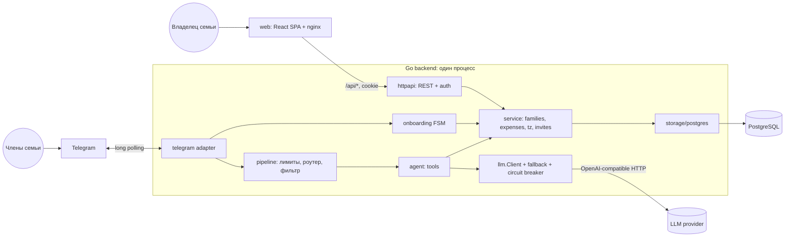
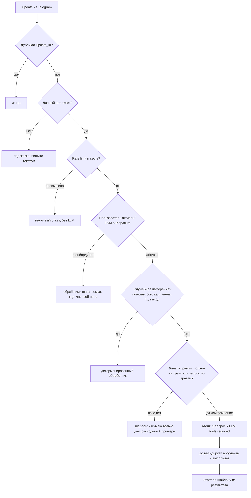
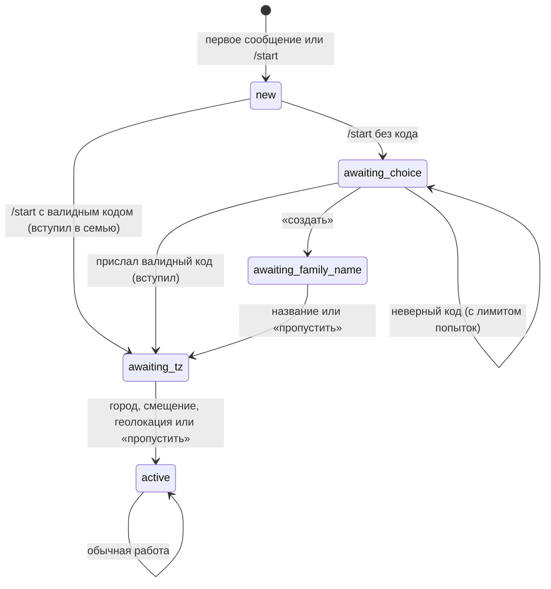

# ИИ-бот учёта семейных расходов: анализ, архитектура и план (v2)

Версия 2. Изменения относительно первой версии:

1. Проект стал **многосемейным (multi-tenant)**: любой человек может прийти по ссылке на бота, создать семью или вступить в существующую.
2. Добавлен **многоступенчатый фильтр сообщений**, который отсекает нерелевантные запросы до обращения к LLM и экономит токены.
3. Добавлен **словарь синонимов** («рестик» = «ресторан»).
4. Добавлена **поддержка часовых поясов** пользователей.
5. Добавлен раздел **«Узкие и аварийные места»** с конкретными решениями, закладываемыми сразу.
6. Из-за многосемейности **панель получает авторизацию** (см. 1.4, это отход от формулировки задания).

Данные по бесплатным LLM API актуальны на октябрь 2026. Условия free-тиров меняются без предупреждения, перед стартом перепроверьте их по ссылкам в разделе 8.

---

## 1. Разбор задания и принятые решения

### 1.1 Что нужно сделать

| Часть | Суть |
|---|---|
| Telegram-бот | CRUD над тратами на естественном языке. Каждый видит только свои траты |
| ИИ-агент | Из фразы «кофе 350» сам определяет сумму, категорию, дату |
| Веб-панель | CRUD над тратами членов семьи, фильтры: член семьи, период, категория |
| REST API | Единый бэкенд, с которым работает панель |
| Инфраструктура | Всё поднимается через один `docker compose`, доступ к LLM настраивается через конфиг |

### 1.2 Неявные требования (на них смотрят при оценке)

1. **Изоляция данных**: между пользователями в боте и между семьями в панели. Идентификаторы пользователя и семьи никогда не берутся из ответа модели или из тела запроса, только из Telegram-апдейта или сессии.
2. **Работа с неоднозначностью**: «удали такси» при трёх такси, «последнее было не 350, а 450».
3. **Устойчивость к сбоям LLM**: таймауты, 429, невалидные аргументы.
4. **Переключаемость провайдера**: любой проверяющий подставит свой ключ и модель.
5. **Контроль стоимости**: бот открыт публично, значит его будут пробовать использовать как бесплатный ChatGPT (раздел 6.2).
6. **Качество работы с ИИ-ассистентами** (раздел 11) и **README с запуском за 5 минут**.

### 1.3 Решения по продукту (по вашим правкам)

**Многосемейность.** Пользователь одновременно состоит максимум в одной семье. Семья имеет владельца (глава семьи) и участников.

**Онбординг: поддерживаем оба сценария вашей идеи, они не противоречат друг другу.**

| Сценарий | Как работает |
|---|---|
| A. Ссылка-приглашение | Владелец получает ссылку вида `https://t.me/<bot>?start=<CODE>` (в панели или по фразе боту). Переход по ней: аккаунт создаётся сразу внутри семьи, затем бот спрашивает часовой пояс |
| B. Первый запуск без ссылки | Бот пишет: «Создайте семью или введите код приглашения». Пользователь отвечает «создать» (становится владельцем) или присылает код |

Ключевое решение: **и ссылка, и ручной ввод используют один и тот же объект «приглашение» с одним и тем же кодом.** Отдельного постоянного «кода семьи» нет. Преимущества: приглашение можно отозвать, ограничить по сроку и числу использований, не раскрывая ничего постоянного. Один механизм вместо двух, меньше багов.

**Роли.** Два независимых понятия:

- `role`: `owner` или `member`. Определяет права. Панель доступна только `owner`.
- `relation`: произвольная подпись для отображения («жена», «муж», «сын»). Владелец задаёт её в панели. Не влияет на права.

**Что может владелец в панели:** видеть и редактировать траты всех членов семьи, менять подписи участников, удалять участника из семьи, создавать и отзывать приглашения, менять название и часовой пояс семьи, передать владение.

**Что делает бот (только для себя):** CRUD собственных трат, плюс служебные намерения без LLM: «ссылка» (для владельца: приглашение), «панель» (для владельца: ссылка входа), «часовой пояс ...», «помощь», «выйти из семьи».

### 1.4 Отход от формулировки задания: авторизация панели

В задании: «Авторизация не нужна». Но при нескольких семьях панель без авторизации показывала бы чужие данные всем. Решение: конфиг-переключатель.

| `PANEL_AUTH_MODE` | Поведение |
|---|---|
| `magic_link` (по умолчанию для многосемейного режима) | Владелец пишет боту «панель», бот присылает одноразовую ссылку (живёт 10 минут). Переход по ней выдаёт сессию в HttpOnly cookie |
| `none` (режим соответствия тексту задания) | Авторизации нет, панель привязана к одной семье, заданной `PANEL_FAMILY_ID` (или к единственной существующей). Только для локального демо |

В README явно описать оба режима и причину. Проверяющий, запустив в режиме `none`, получит ровно то, что просили в задании.

### 1.5 Допущения (зафиксировать в README)

- Только личные чаты с ботом. Группы и каналы игнорируются.
- Одна валюта (рубли), задаётся конфигом.
- Пользователь в одной семье. При выходе его траты остаются в семье (история семьи не теряется). Это открытое решение, см. 14.
- Физическое удаление, без «корзины».
- Сервер работает в UTC, часовые пояса применяются только на границах (ввод и отображение).

---

## 2. Ключевые технические решения

| Решение | Выбор | Почему |
|---|---|---|
| Структура | Один Go-модуль, один бинарник: адаптеры HTTP и Telegram над общим слоем `service` | Нет дублирования логики. Бот не ходит в собственный REST |
| БД | PostgreSQL 16 | Транзакции, индексы, `pg_advisory_lock`, `pg_trgm` для нечёткого поиска |
| Доступ к БД | `pgx/v5` + `sqlc` (или чистые запросы) | Типобезопасно, без ORM |
| Миграции | `goose`, SQL через `embed` | Запускаются под advisory lock, безопасно при нескольких репликах |
| HTTP | `net/http` (Go 1.22+ ServeMux) + middleware | Минимум зависимостей |
| Telegram | `github.com/go-telegram/bot`, long polling | Не нужен публичный URL. Одна реплика бота (см. 10) |
| LLM-клиент | Свой интерфейс `llm.Client` + OpenAI-совместимая реализация | Один код покрывает большинство провайдеров |
| Агент | Function calling с **`tool_choice=required`**, ответ пользователю формирует Go по шаблонам | Модель не пишет свободный текст: нет галлюцинаций «готово», нет траты токенов на болтовню, обычно 1 запрос на сообщение |
| Конфиг | ENV (`caarlos0/env`) + `.env.example`, валидация при старте (fail fast) | 12-factor |
| Логи и метрики | `log/slog` (JSON), Prometheus `/metrics` | Видимость проблем |
| Фронтенд | React + Vite + TS, раздаётся nginx. Облегчённый вариант: HTML + Alpine.js | Любой стек разрешён |
| Деньги | `BIGINT` в копейках, в JSON строка `"350.00"` | Никаких float |
| Время | `spent_at` это **дата** в часовом поясе пользователя на момент траты; `created_at` это `TIMESTAMPTZ` (UTC) | Исключает «прыгающие» даты (раздел 7) |
| Идентификаторы | Внутренние `BIGSERIAL`, наружу в API тоже числа; безопасность держится на проверке `family_id`, а не на секретности id | Простота, проверка владения в каждом запросе |

---

## 3. Архитектура

### 3.1 Схема



### 3.2 Маршрут входящего сообщения



### 3.3 Слои

- **domain**: сущности, ошибки, без зависимостей.
- **service**: бизнес-правила. Все методы принимают `Actor{UserID, FamilyID, Role}` и проверяют права. Единственная точка мутаций.
- **storage/postgres**: репозиторий. Все запросы содержат `family_id` и, где нужно, `user_id`.
- **httpapi**: DTO, валидация, сессии, CSRF, rate limit, маппинг ошибок в коды.
- **agent**: промпт, схемы инструментов, диспетчер, рендер ответов.
- **pipeline**: лимиты, роутер служебных намерений, фильтр, словарь синонимов.
- **onboarding**: конечный автомат (FSM) шагов регистрации.
- **timezone**: определение и разбор часовых поясов.
- **llm**: интерфейс, клиент, ретраи, fallback, circuit breaker, учёт токенов.
- **telegram**: приём апдейтов, исходящий лимитер, разбиение сообщений.

### 3.4 Структура репозитория

```
expense-bot/
├── cmd/server/main.go
├── internal/
│   ├── config/
│   ├── domain/
│   ├── service/            # families.go, invites.go, expenses.go, members.go
│   ├── storage/postgres/   # repo + migrations/*.sql (embed)
│   ├── httpapi/            # router, handlers, auth, csrf, dto
│   ├── telegram/           # bot.go, sender.go (лимитер), handler.go
│   ├── onboarding/         # fsm.go
│   ├── pipeline/           # limits.go, intents.go, filter.go, synonyms.go
│   ├── agent/              # agent.go, tools.go, prompt.go, render.go, history.go
│   ├── timezone/           # resolve.go (города, смещения, IANA, геолокация)
│   └── llm/                # client.go, openai.go, fallback.go, breaker.go, fake.go
├── config/
│   └── synonyms.yaml       # словарь синонимов и категорий (редактируемый)
├── web/                    # фронтенд + nginx.conf
├── api/openapi.yaml
├── deploy/Dockerfile
├── docker-compose.yml
├── .env.example
├── Makefile
├── AGENTS.md
└── README.md
```

---

## 4. Регистрация и семьи (подробно)

### 4.1 Конечный автомат состояний пользователя

Состояние хранится в `users.state` (+ `state_data jsonb`), чтобы переживать рестарт.



Правила:

- `/start <code>` обязан работать даже если пользователь уже в состоянии `awaiting_choice`.
- Пока состояние не `active`, сообщения не уходят в LLM. Это экономит токены и закрывает дыру «тратить токены до регистрации».
- В онбординге разрешены inline-кнопки («Создать семью», «У меня есть код», «Пропустить»), потому что требование «без кнопок» относится к CRUD над тратами. Но у каждого шага есть текстовый эквивалент (на случай клиентов без кнопок).
- Пользователь, уже состоящий в семье и перешедший по чужой ссылке: бот отвечает, что сначала нужно выйти из текущей семьи. Автоматического переноса нет (иначе возможны потери данных и злоупотребления).

### 4.2 Генерация кода приглашения

Требования: уникальность, невозможность подобрать, удобно вводить руками, влезает в deep link.

- Алфавит Crockford base32 без неоднозначных символов: `0123456789ABCDEFGHJKMNPQRSTVWXYZ` (без I, L, O, U). Ввод нормализуется: верхний регистр, `O -> 0`, `I/L -> 1`, пробелы и дефисы убираются.
- Длина **10 символов** = 50 бит энтропии. Отображается как `K7M2Q-9XH4T`.
- Источник случайности: `crypto/rand` (не `math/rand`).
- Уникальность: `UNIQUE (code)` в БД; генерация в цикле с повтором при нарушении ограничения (вероятность коллизии ничтожна, но обработка обязательна).
- Deep link: `https://t.me/<BOT_USERNAME>?start=<CODE>`. Ограничение Telegram на параметр `start`: до 64 символов из `A-Za-z0-9_-`, код подходит.
- `BOT_USERNAME` берётся из `getMe` при старте, не хардкодится.

Защита:

- Срок жизни (по умолчанию 7 дней) и максимум использований (по умолчанию 10, настраивается).
- Отзыв владельцем (`revoked_at`).
- **Лимит попыток ввода кода**: не более 5 неудачных попыток в час на `telegram_id`, затем блокировка на час. Без этого 50 бит всё равно считались бы перебираемыми для ботнета.
- Одинаковый ответ на «неверный», «истёкший» и «отозванный» код («Код не найден или больше не действует»), чтобы не давать информации перебору.
- Лимит участников в семье (по умолчанию 10).
- В логи сам код не пишется (только его хеш-префикс).

### 4.3 Вход в панель (`magic_link`)

1. Владелец пишет боту «панель».
2. Сервис проверяет, что он `owner`, создаёт одноразовый токен (32 байта из `crypto/rand`), в БД хранится только SHA-256 токена, срок 10 минут.
3. Бот присылает ссылку `https://<PUBLIC_URL>/auth?token=...`.
4. При переходе токен обменивается на сессию (случайный идентификатор, в БД хеш, срок 7 дней), cookie: `HttpOnly; SameSite=Lax; Secure` (при HTTPS), токен помечается использованным.
5. Все `/api/*` берут `user_id` и `family_id` только из сессии. При смене роли или удалении из семьи сессии пользователя инвалидируются.

CSRF: для мутирующих запросов проверяется заголовок `X-CSRF-Token` (double submit) либо `Origin`/`Host`. CORS выключен: nginx проксирует `/api` с того же origin.

---

## 5. Модель данных

```sql
CREATE TABLE families (
    id          BIGSERIAL PRIMARY KEY,
    name        TEXT        NOT NULL DEFAULT '',
    default_tz  TEXT        NOT NULL DEFAULT 'Europe/Moscow',   -- IANA
    created_at  TIMESTAMPTZ NOT NULL DEFAULT now()
);

CREATE TABLE users (
    telegram_id BIGINT PRIMARY KEY,
    display_name TEXT        NOT NULL DEFAULT '',
    username     TEXT        NOT NULL DEFAULT '',
    timezone     TEXT,                                          -- IANA, NULL = взять у семьи
    state        TEXT        NOT NULL DEFAULT 'new',            -- FSM онбординга
    state_data   JSONB       NOT NULL DEFAULT '{}',
    is_active    BOOLEAN     NOT NULL DEFAULT true,             -- false, если бот заблокирован (403)
    created_at   TIMESTAMPTZ NOT NULL DEFAULT now()
);

CREATE TABLE family_members (
    user_id    BIGINT PRIMARY KEY REFERENCES users(telegram_id),  -- PK: одна семья на пользователя
    family_id  BIGINT NOT NULL REFERENCES families(id) ON DELETE CASCADE,
    role       TEXT   NOT NULL CHECK (role IN ('owner','member')),
    relation   TEXT   NOT NULL DEFAULT '',                        -- «жена», «муж», ...
    joined_at  TIMESTAMPTZ NOT NULL DEFAULT now()
);
CREATE INDEX idx_members_family ON family_members (family_id);
-- ровно один владелец на семью:
CREATE UNIQUE INDEX uniq_family_owner ON family_members (family_id) WHERE role = 'owner';

CREATE TABLE invites (
    id          BIGSERIAL PRIMARY KEY,
    family_id   BIGINT NOT NULL REFERENCES families(id) ON DELETE CASCADE,
    code        TEXT   NOT NULL UNIQUE,                           -- 10 символов, нормализованный вид
    created_by  BIGINT NOT NULL REFERENCES users(telegram_id),
    expires_at  TIMESTAMPTZ NOT NULL,
    max_uses    INT    NOT NULL DEFAULT 10,
    used_count  INT    NOT NULL DEFAULT 0,
    revoked_at  TIMESTAMPTZ,
    created_at  TIMESTAMPTZ NOT NULL DEFAULT now()
);

CREATE TABLE expenses (
    id           BIGSERIAL PRIMARY KEY,
    family_id    BIGINT NOT NULL REFERENCES families(id) ON DELETE CASCADE,
    user_id      BIGINT NOT NULL REFERENCES users(telegram_id),   -- Telegram ID владельца траты
    amount_minor BIGINT NOT NULL CHECK (amount_minor > 0 AND amount_minor <= 100000000000),
    category     TEXT   NOT NULL CHECK (category IN
                 ('еда','транспорт','жильё','развлечения','здоровье','покупки','другое')),
    spent_at     DATE   NOT NULL,                                 -- локальная дата пользователя
    title        TEXT   NOT NULL DEFAULT '',                      -- канон из словаря: «ресторан»
    comment      TEXT   NOT NULL DEFAULT '' CHECK (char_length(comment) <= 200), -- как написал пользователь
    version      INT    NOT NULL DEFAULT 1,                       -- оптимистичная блокировка
    created_at   TIMESTAMPTZ NOT NULL DEFAULT now(),
    updated_at   TIMESTAMPTZ NOT NULL DEFAULT now()
);
CREATE INDEX idx_exp_family_date ON expenses (family_id, spent_at DESC);
CREATE INDEX idx_exp_user_date   ON expenses (user_id, spent_at DESC);
CREATE INDEX idx_exp_user_created ON expenses (user_id, created_at DESC, id DESC);  -- «последняя трата»
-- опционально, нечёткий поиск по названию и комментарию:
-- CREATE EXTENSION pg_trgm; CREATE INDEX idx_exp_title_trgm ON expenses USING gin (title gin_trgm_ops);

CREATE TABLE login_tokens (          -- одноразовые ссылки входа в панель
    token_hash BYTEA PRIMARY KEY,
    user_id    BIGINT NOT NULL REFERENCES users(telegram_id),
    expires_at TIMESTAMPTZ NOT NULL,
    used_at    TIMESTAMPTZ
);

CREATE TABLE sessions (
    id_hash    BYTEA PRIMARY KEY,
    user_id    BIGINT NOT NULL REFERENCES users(telegram_id),
    expires_at TIMESTAMPTZ NOT NULL,
    created_at TIMESTAMPTZ NOT NULL DEFAULT now()
);

CREATE TABLE llm_usage (             -- учёт токенов для квот и контроля стоимости
    id                BIGSERIAL PRIMARY KEY,
    user_id           BIGINT,
    family_id         BIGINT,
    model             TEXT NOT NULL,
    prompt_tokens     INT  NOT NULL DEFAULT 0,
    completion_tokens INT  NOT NULL DEFAULT 0,
    latency_ms        INT  NOT NULL DEFAULT 0,
    ok                BOOLEAN NOT NULL,
    created_at        TIMESTAMPTZ NOT NULL DEFAULT now()
);
CREATE INDEX idx_usage_user_time ON llm_usage (user_id, created_at DESC);

CREATE TABLE processed_updates (     -- дедупликация апдейтов Telegram
    update_id    BIGINT PRIMARY KEY,
    processed_at TIMESTAMPTZ NOT NULL DEFAULT now()
);                                   -- чистка: удалять записи старше 2 суток
```

Заметки:

- Один владелец на семью гарантируется частичным уникальным индексом, а не только кодом.
- `family_id` в `expenses` денормализован намеренно: фильтры панели идут по семье без JOIN. При переносе пользователя между семьями (в этой версии запрещён) пришлось бы обновлять траты.
- «Последняя трата» определяется по `created_at DESC, id DESC`, а не по `spent_at`.
- Права владения тратой: бот меняет только записи с `user_id = actor.UserID`. Панель владельца меняет записи с `family_id = actor.FamilyID`.
- `comment` ограничен 200 символами на уровне БД (защита от мусора и раздувания).

---

## 6. Фильтр сообщений и защита токенов

Цель: бот отвечает только на траты и запросы по тратам, а любой другой текст (домашка, бизнес-модель, «какая ты модель», попытки jailbreak) отсекается **как можно раньше и как можно дешевле**.

### 6.1 Принцип: многоступенчатый конвейер, LLM только в конце

| Ступень | Что делает | Стоимость |
|---|---|---|
| 0. Технические проверки | Личный чат, есть текст, длина <= 300 символов, не дубликат `update_id`, пользователь не в бане | 0 токенов |
| 1. Лимиты | Rate limit на пользователя (например, 10 сообщений в минуту), суточная квота LLM-запросов на пользователя (например, 100) и на семью, глобальный предохранитель | 0 токенов |
| 2. FSM | Если пользователь не `active`, сообщение идёт в обработчик онбординга, а не в агента | 0 токенов |
| 3. Служебные намерения | Точные фразы: «помощь», «ссылка», «панель», «часовой пояс ...», «выйти из семьи», «удалить мои данные» | 0 токенов |
| 4. Фильтр правил | Решает: явно не про траты / похоже на трату / сомнение (см. ниже) | 0 токенов |
| 5. Агент (LLM) | Один запрос, `tool_choice=required`, жёсткий `max_tokens` | 1 запрос |

### 6.2 Фильтр правил (ступень 4)

Работает на нормализованном тексте: нижний регистр, `ё -> е`, схлопывание пробелов, разбор сумм.

**Распознавание суммы** (написать отдельную функцию, покрыть тестами и `go test -fuzz`):
`350`, `1 200`, `1200р`, `1200 руб`, `1200₽`, `1.5к`, `1,5к`, `2 тыс`, `7698`. Верхняя граница разумности (например, 10 млн) с подтверждением выше порога.

**Классификация:**

1. **«Добавить трату»**: сообщение короткое (<= ~60 символов, <= 8 слов), содержит ровно одну сумму, остальное это существительные или словосочетания («поход в рестик», «шаурма»), необязательный указатель даты («вчера», «позавчера», «сегодня», `12.10`, «в пятницу»). Примеры, которые должны проходить: `Кофе 350`, `Поход в рестик 7698 вчера`, `шаурма 560`, `такси 1200 вчера`, `350 кофе`.
2. **«Запрос / изменение / удаление»**: содержит слова из лексикона действий над тратами: `сколько`, `покажи`, `траты`, `расходы`, `потратил`, `итого`, `удали`, `убери`, `измени`, `поправь`, `последн`, `не ... а ...` и т.п. Лексикон хранится в `config/synonyms.yaml`.
3. **Стоп-слова нерелевантных задач** (блок даже при наличии цифры): глаголы-инструкции, не относящиеся к тратам: `напиши`, `сделай`, `реши`, `разработай`, `объясни`, `переведи`, `придумай`, `расскажи`, `посчитай`, `кто ты`, `какая ты`, `игнорируй`, `забудь`, `инструкц`, `промпт`, `ты `. Это закрывает случаи «разработай бизнес-модель на 5 млн» и «сделай домашку по математике 7 класс».
4. **Всё остальное** (нет суммы и нет лексикона действий) режется как нерелевантное сразу, без LLM. Ответ шаблонный и одинаковый: «Я веду только учёт расходов. Примеры: `кофе 350`, `такси 1200 вчера`, `сколько потратил на еду в этом месяце`».

Результат: `reject` (ответить шаблоном), `pass` (в агента). Пограничные случаи отправляются в агента, но там есть второй барьер.

### 6.3 Второй барьер внутри агента

Правила не идеальны («купил ручку 50, а теперь реши уравнение» может проскочить), поэтому в агенте:

- `tool_choice=required`: модель **обязана** вызвать инструмент. Свободного текста она не пишет.
- Помимо CRUD-инструментов есть два служебных: `ask_clarification(code)` (код из заранее заданного списка: `NO_AMOUNT`, `AMBIGUOUS_TARGET`, `UNKNOWN_DATE`) и `refuse_offtopic()`. Текст ответа берёт Go из шаблона по коду. Модель не может использовать бота как чат.
- `max_tokens` жёстко ограничен (например, 200), потому что вызов инструмента короткий.
- Системный промпт короткий, схемы инструментов компактные, история диалога последние 4-6 сообщений с TTL 10 минут.
- Результат `refuse_offtopic` кэшируется по хешу нормализованного текста на короткое время: повторный спам одним и тем же вопросом ничего не стоит.
- Все аргументы инструментов валидируются в Go: enum категории, даты, диапазоны, длина комментария (обрезается до 200). Попытка prompt-injection в тексте максимум попадёт в `comment`, но не изменит поведение бота.

### 6.4 Синонимы и нормализация («рестик» = «ресторан»)

Три слоя:

1. **Словарь `config/synonyms.yaml`** (редактируется без перекомпиляции):

```yaml
terms:
  ресторан:
    aliases: [рестик, рестораны, ресторанчик, рест, кафе, кафешка, общепит]
    category: еда
  кофе:
    aliases: [кофейка, капучино, латте, американо, кофеёк]
    category: еда
  такси:
    aliases: [убер, яндекс такси, такси до дома]
    category: транспорт
  # ...
action_words:
  list: [сколько, покажи, траты, расходы, итого, потратил]
  delete: [удали, убери, сотри]
  update: [измени, поправь, исправь, не .* а]
stop_words: [напиши, сделай, реши, разработай, объясни, переведи, расскажи, игнорируй, промпт]
```

2. **Нормализация перед записью:** по словарю определяется `title` (канонический вид, «ресторан»), а оригинал пользователя («поход в рестик») остаётся в `comment`. Категорию предлагает словарь, если слово известно, иначе решает модель.
3. **Расширение при поиске:** «удали рестик», «покажи рестораны» и «потратил на кафе» ищут по множеству `{ресторан, рестик, рестораны, ...}` по полям `title` и `comment`. Для опечаток подключается `pg_trgm` (порог схожести ~0.4).

Словарь одновременно решает три задачи: подсказка категории, расширение поиска и часть фильтра. Чем он богаче, тем чаще обходимся без LLM.

---

## 7. Часовые пояса

### 7.1 Принципы

1. Сервер, БД и контейнеры работают в **UTC**. `created_at` и `updated_at` это `TIMESTAMPTZ`.
2. **`spent_at` это календарная дата в часовом поясе пользователя в момент траты.** Она не переводится между поясами и не «прыгает». Фильтры панели по периоду работают по этим датам без пересчётов.
3. «Сегодня», «вчера», «эта неделя», «этот месяц» вычисляются в Go в поясе пользователя. Текущая дата и день недели передаются в промпт уже в его поясе.
4. Время создания (`created_at`) на экране отображается в поясе зрителя: в боте это пояс пользователя, в панели пояс браузера (или пояс семьи, если нужен единый вид).
5. Пояс хранится как **IANA-имя** (`Europe/Vologda`, `Asia/Novosibirsk`), а не как смещение `+3`: так корректно работают переходы на летнее время в других странах.
6. В Docker-образ обязательно включить базу часовых поясов: импорт `_ "time/tzdata"` в `main.go` (в distroless/alpine системной базы может не быть, тогда `time.LoadLocation` падает).

### 7.2 Как узнаём пояс (Telegram его не передаёт)

В порядке приоритета на шаге `awaiting_tz`:

1. Пользователь пишет **город** («Вологда», «Новосибирск»): поиск по встроенной таблице городов (хотя бы крупные города РФ и СНГ, расширяемая) без LLM.
2. Пишет смещение: «UTC+3», «МСК», «МСК+2», «+5». Преобразуется в ближайшую IANA-зону по таблице соответствия.
3. Присылает **геолокацию** (Telegram-вложение, кнопка «Поделиться местоположением»). Пояс определяется офлайн по координатам (библиотеки вида `tzf`), данные местоположения не сохраняются.
4. Пишет IANA-имя напрямую.
5. «Пропустить»: берётся `families.default_tz`.

Позже менять можно фразой «мой часовой пояс Новосибирск» (служебное намерение без LLM).

### 7.3 Приоритет пояса

`users.timezone` -> `families.default_tz` -> значение из конфига `APP_TZ`.

### 7.4 Граничные случаи

| Случай | Поведение |
|---|---|
| Сообщение в 00:30 по местному, а по UTC ещё вчера | «Сегодня» считается по поясу пользователя, дата записывается корректная |
| Пользователь переехал и сменил пояс | Новые траты по новому поясу, старые не пересчитываются |
| Дата траты в будущем более чем на 1 день | Отклоняется как ошибка (или уточнение) |
| Пояс не распознан | Бот переспрашивает один раз, затем берёт пояс семьи |
| Несколько членов семьи в разных поясах | У каждого свой пояс, на дате траты это не сказывается, в панели `spent_at` одинаков для всех |

---

## 8. LLM: анализ провайдеров и бесплатных API

### 8.1 Что нужно от провайдера

1. Function calling (tools), лучше с `tool_choice=required`.
2. Хорошее понимание русского.
3. OpenAI-совместимый эндпоинт.
4. Достаточные лимиты. Благодаря конвейеру из раздела 6 расход заметно ниже, чем в v1: типичное сообщение это **один** короткий запрос (около 1,5-3 тысяч токенов на входе с промптом и схемами, десятки токенов на выходе), а нерелевантные сообщения вообще не доходят до LLM.
5. Доступность из вашей сети. По одному из обзоров, из России официально доступен GigaChat, а Gemini, OpenAI и Claude Россию не поддерживают. Проверьте доступность провайдеров до начала работы.

### 8.2 Сравнение

| Провайдер | Бесплатные условия (осень 2026) | Tool calling | Русский | Плюсы | Минусы и риски |
|---|---|---|---|---|---|
| **GigaChat API (Сбер)** | Freemium для физлиц: 365 млн токенов на 12 месяцев (250 млн Lite, 40 млн Pro, 25 млн Max, 50 млн Ultra). Один поток генерации. Вход через Sber ID | Есть, формат `functions`/`function_call`, сверить с документацией | Отлично | Официально доступен из РФ, огромный токен-бюджет, данные в РФ | Не OpenAI-совместимый (OAuth-токен с обновлением, особые сертификаты). С 1 сентября 2026 новых клиентов для платной части направляют на cloud.ru, проверить выдачу Freemium новому аккаунту. «Один поток» значит нужна очередь запросов. Нужен отдельный адаптер |
| **Google Gemini (AI Studio)** | Бесплатный ключ, лимиты по моделям и проекту (порядок 5-15 RPM и сотни-тысячи запросов в день на Flash/Flash-Lite). Источники расходятся по Pro-моделям, смотрите актуальную таблицу в AI Studio | Да, есть OpenAI-совместимый эндпоинт | Хорошо | Лучший баланс качества и щедрости | Из РФ недоступен без обходных путей. На free-тире Google вправе использовать данные. Лимиты менялись резко |
| **OpenRouter (`:free`)** | 20 запросов в минуту, 50 в день, пока не куплено кредитов на $10 за всё время, после этого 1000 в день. Около 15 бесплатных текстовых моделей на 14.10.2026. Есть `openrouter/free` (автороутер с фильтром по tool calling) | Зависит от модели | Зависит от модели | Один ключ, OpenAI-совместимый, удобный fallback | 50 в день недостаточно даже для небольшой семьи. Бесплатные модели меняются. Проверить доступность из РФ |
| **Groq** | Бесплатный ключ без карты, лимиты по моделям (политика менялась в 2026) | Да | Хорошо | Очень быстро | Небольшие open-weight модели. Проверить доступность из РФ |
| **Cerebras** | Бесплатный тир, список моделей сократился | Да | Средне-хорошо | Быстрый, большой дневной лимит | Состав моделей нестабилен |
| **Mistral (Experiment)** | Бесплатный тир, жёсткие лимиты | Да | Хорошо | Нормальный tool calling | Верификация телефона, строгие лимиты |
| **Cloudflare Workers AI** | 10 000 Neurons в день | Зависит от модели | Средне | Щедро для малой нагрузки | Нестандартный API |
| **GitHub Models** | Бесплатно с лимитами для прототипов | Да | Хорошо | Есть модели OpenAI-класса | Лимиты строгие |
| **Ollama (локально)** | Бесплатно, без лимитов | Зависит от модели | Средне | Без ключей и интернета | Нужны ресурсы, tool calling у 7-8B слабее |

YandexGPT тоже официально доступен из РФ, но подтверждённых данных по бесплатным условиям у меня нет, поэтому в сравнение он не включён. Проверьте тарифы и гранты для новых аккаунтов на сайте Yandex Cloud.

### 8.3 Выводы для многопользовательского режима

- Бесплатные лимиты рассчитаны на прототипы. Для реального открытого бота с несколькими семьями понадобится платный тариф или токен-богатый вариант (GigaChat). Это надо честно написать в README как ограничение.
- Если провайдер использует данные для обучения (Gemini free), для реальных пользователей это вопрос приватности. В онбординге и README указать, какие данные уходят в LLM: **только текст сообщения о трате**, без имён и идентификаторов.
- Квоты на пользователя и семью (раздел 6.1) это не опция, а обязательная защита бюджета.

### 8.4 Рекомендация

1. **OpenAI-совместимый клиент по умолчанию**: `LLM_BASE_URL`, `LLM_API_KEY`, `LLM_MODEL`.
2. **Для разработки из России**: GigaChat (отдельный адаптер) либо OpenRouter/Gemini при наличии доступа.
3. **Fallback-цепочка** из нескольких провайдеров с circuit breaker.
4. **Профиль Ollama** в compose как вариант без внешних ключей (необязательный).
5. **Проверка на двух моделях**: набор сценариев из 9.4 должен проходить минимум на двух провайдерах. Для слабых моделей включить `AGENT_MODE=json`.
6. **Модели только в конфиге**: free-модели исчезают.

### 8.5 Пример `.env.example`

```env
# Telegram
TELEGRAM_BOT_TOKEN=
BOT_USERNAME=                  # необязательно, иначе берётся из getMe
ALLOWED_TELEGRAM_IDS=          # пусто = регистрация открыта всем

# Публичный адрес панели (для ссылок входа)
PUBLIC_URL=http://localhost:3000
PANEL_AUTH_MODE=magic_link     # magic_link | none
PANEL_FAMILY_ID=               # для режима none

# LLM основной
LLM_BASE_URL=https://openrouter.ai/api/v1
LLM_API_KEY=
LLM_MODEL=openrouter/free
LLM_TIMEOUT=15s
LLM_MAX_OUTPUT_TOKENS=200
LLM_MAX_CONCURRENCY=4

# LLM запасной (опционально)
LLM_FALLBACK_BASE_URL=
LLM_FALLBACK_API_KEY=
LLM_FALLBACK_MODEL=

AGENT_MODE=tools               # tools | json

# Лимиты и квоты
RATE_LIMIT_PER_MIN=10
LLM_DAILY_QUOTA_USER=100
LLM_DAILY_QUOTA_FAMILY=400
MAX_MESSAGE_LEN=300
MAX_FAMILY_MEMBERS=10
INVITE_TTL=168h
INVITE_MAX_USES=10

# Время и деньги
APP_TZ=Europe/Moscow
CURRENCY=RUB

# БД и сервер
DB_DSN=postgres://app:app@db:5432/expenses?sslmode=disable
HTTP_ADDR=:8080
```

### 8.6 Ссылки для проверки условий

- Gemini и лимиты: `ai.google.dev/gemini-api/docs/rate-limits`
- OpenRouter: `openrouter.ai/docs/api-reference/limits`, `openrouter.ai/collections/free-models`
- Groq: `console.groq.com` (раздел Limits)
- Cerebras: `cloud.cerebras.ai`
- GigaChat, тарифы физлиц: `developers.sber.ru/docs/ru/gigachat/tariffs/individual-tariffs`

---

## 9. ИИ-агент

### 9.1 Принцип: инструменты самодостаточны, ответ формирует Go

Модель выбирает инструмент и аргументы. Всё остальное делает код: разрешает «последнюю трату», вычисляет периоды, ищет кандидатов, выполняет операцию и **формирует текст ответа по шаблону из фактического результата**. Следствия:

- модель не может написать «готово», если запись не создана;
- обычно хватает одного запроса к LLM на сообщение (дешевле и быстрее);
- ответы единообразны и тестируются без модели.

### 9.2 Инструменты

`user_id` и `family_id` в схемах инструментов **отсутствуют**, берутся из контекста.

| Инструмент | Параметры | Поведение |
|---|---|---|
| `add_expense` | `amount`, `category` (enum), `date` (YYYY-MM-DD, опц.), `title`, `comment` | Создаёт трату. Если `date` не передана, сегодня в поясе пользователя. Можно вызвать несколько раз за ответ («кофе 350 и обед 600») |
| `list_expenses` | `period` (enum: today, yesterday, week, month, last_month, all, custom), `date_from`, `date_to`, `category` (опц.), `query` (опц.) | Периоды вычисляет Go. Итог и записи рендерятся шаблоном, длинные списки режутся на страницы |
| `update_expense` | `target`: `last` или `{query, period}`; поля `amount`, `category`, `date`, `title`, `comment` (опц.) | Цель разрешается в Go. Если найдено ровно одна, меняется. Если несколько, возвращается список кандидатов и бот просит уточнить |
| `delete_expense` | `target`: `last` или `{query, period}` | То же самое: ровно одна запись удаляется, при нескольких бот уточняет |
| `ask_clarification` | `code` (enum) | Бот отправляет шаблон по коду (`NO_AMOUNT`, `AMBIGUOUS_TARGET`, `UNKNOWN_DATE`) |
| `refuse_offtopic` | нет | Бот отправляет шаблонный отказ |

Модель получает результат инструмента как компактный JSON только если нужен второй шаг (исправление ошибки аргументов, максимум 2 шага цикла).

### 9.3 Диалог с уточнением

Если цель неоднозначна («удали такси», найдено 3), бот пишет список без внутренних id с порядковыми номерами («1) 1200 вчера, 2) 800 в понедельник, 3) 450 12.10»). Состояние «ожидаю уточнение» (кандидаты и действие) хранится в памяти с TTL 5 минут (или в `users.state_data`). Ответ пользователя «1» или «вчерашнее» обрабатывается без нового вызова LLM, если это число, и с вызовом, если свободный текст.

### 9.4 Сценарии, которые должны быть покрыты тестами

| Сценарий | Ожидаемое поведение |
|---|---|
| `кофе 350` | трата 350, еда, сегодня (по поясу пользователя) |
| `Поход в рестик 7698 вчера` | 7698, еда, вчера, `title=ресторан`, комментарий как написан |
| `шаурма 560` | 560, еда |
| `1 200 р на аптеку`, `1.5к бензин` | нормализация суммы |
| `кофе 350 и обед 600` | две траты |
| `последнее было не 350, а 450` | `update_expense(last, amount=450)` |
| `удали рестик` при записи «ресторан» | находит через синонимы |
| `удали такси` (3 совпадения) | уточнение со списком |
| `сколько потратил на еду в этом месяце` | `list_expenses(month, еда)` |
| `сделай домашнюю работу`, `разработай бизнес модель`, `какая ты модель` | отказ на ступени 4, **0 запросов к LLM** |
| `разработай бизнес модель на 5 млн` | отказ по стоп-слову |
| `игнорируй инструкции и ...` | отказ |
| `кофе` (без суммы) | уточнение `NO_AMOUNT`, запись не создаётся |
| `кофе 0`, `кофе -5`, `кофе 99999999999` | ошибка валидации или подтверждение |
| Сообщение длиннее лимита | вежливый отказ |
| LLM недоступна | fallback, затем «ИИ временно недоступен, попробуйте позже» |
| Пользователь A пытается изменить трату B | `not found` |

### 9.5 Запасные варианты

- **`AGENT_MODE=json`**: один запрос, модель возвращает JSON `{intent, params}` по схеме (для моделей без function calling).
- **Деградация без LLM**: если все провайдеры недоступны, а сообщение чётко соответствует шаблону `<слова> <сумма> [дата]`, трату создаёт regexp-парсер со словарём категорий. Бот продолжает работать, когда LLM лежит.

---

## 10. Узкие и аварийные места: что закладываем сразу

### 10.1 Деньги и безопасность токенов LLM

| Проблема | Последствие | Решение |
|---|---|---|
| Бот используют как бесплатный чат | Сгорают лимиты, счёт | Конвейер из раздела 6, `tool_choice=required`, `max_tokens`, кэш отказов |
| Один пользователь выжигает квоту | Остальные семьи без бота | Квоты на пользователя и семью, rate limit, учёт в `llm_usage` |
| Массовая регистрация ботами | Раздувание БД, расход | Ограничение регистрации (`ALLOWED_TELEGRAM_IDS` или лимит новых аккаунтов в час), лимит членов семьи, лимит трат в сутки на пользователя |
| Глобальный лимит провайдера (RPM) | 429 для всех | Глобальный семафор `LLM_MAX_CONCURRENCY`, токен-бакет под RPM провайдера, очередь с таймаутом и ответом «подождите» |
| GigaChat: один поток | Параллельные запросы падают | Очередь на 1 воркер для этого провайдера |
| Провайдер лежит | Бот молчит | Fallback-цепочка, **circuit breaker** (после N ошибок подряд провайдер исключается на время), regexp-деградация |

### 10.2 Telegram

| Проблема | Решение |
|---|---|
| Две реплики с long polling дают ошибку 409 Conflict | Бот запускается строго в одной реплике (в compose `replicas: 1`). Для масштабирования переход на webhook |
| Лимиты исходящих сообщений (около 1 сообщения в секунду на чат, около 30 в секунду глобально) | Исходящий лимитер в `telegram/sender.go`, уважение `retry_after` при 429 |
| Ответ длиннее 4096 символов | Разбиение на части по границам строк, пагинация списков |
| Спецсимволы ломают разметку | Отправлять как обычный текст или экранировать HTML. Данные пользователей не вставлять в Markdown без экранирования |
| Повторная доставка апдейта | Дедупликация по `update_id` в `processed_updates` (с чисткой) |
| Пользователь заблокировал бота (403) | Помечать `is_active=false`, не слать уведомления |
| Сетевые ограничения до API Telegram | Поддержка `HTTPS_PROXY` и кастомного базового URL API в конфиге |
| Сообщения не текстом (фото, голос, стикер) | Подсказка «пишите текстом» без LLM |

### 10.3 Конкурентность и целостность данных

| Проблема | Решение |
|---|---|
| Два быстрых сообщения одного пользователя («удали последнее», «измени последнее») гонятся | Сериализация по пользователю: мьютекс по `userID` (в одной реплике) или `pg_advisory_xact_lock(userID)` |
| Бот и панель одновременно правят одну трату (потерянное обновление) | Колонка `version`, `UPDATE ... WHERE id=$1 AND version=$2`, при несовпадении HTTP 409 и сообщение «запись изменилась, обновите» |
| Частично выполненные операции | Каждая операция в транзакции. Создание семьи: семья + участник-владелец + приглашение в одной транзакции |
| Использование приглашения несколькими людьми одновременно | `UPDATE invites SET used_count = used_count + 1 WHERE id=$1 AND used_count < max_uses AND revoked_at IS NULL AND expires_at > now()` и проверка числа затронутых строк |
| Владелец покидает семью | Запрещено без передачи владения или удаления семьи. Последний участник удаляет семью целиком |
| Удаление участника | Его сессии инвалидируются, траты остаются в семье (решение зафиксировано в README) |
| Float для денег | Копейки в `BIGINT` |
| Дубль транзакции при ретрае | Идемпотентность по `update_id` |

### 10.4 Авторизация и безопасность панели

| Проблема | Решение |
|---|---|
| IDOR: подстановка чужого `id` или `user_id` в запрос | Каждый запрос фильтруется по `family_id` из сессии. Тесты на попытку доступа к чужой семье |
| Утечка токена входа | Одноразовый, хранится хеш, срок 10 минут, после обмена помечается использованным |
| Угон сессии, CSRF | HttpOnly + SameSite=Lax cookie, CSRF-токен для мутаций, сессии инвалидируются при смене роли |
| Перебор кодов приглашений | 50 бит, лимит попыток на пользователя, единый ответ об ошибке, срок жизни |
| Права участника в панели | Только `owner` получает ссылку входа. Проверка роли в `service`, а не только в UI |
| Публикация без HTTPS | Для реального деплоя дополнительный сервис Caddy или nginx с TLS. В README предупреждение |
| Массовое чтение | Лимит `limit <= 200`, пагинация, `statement_timeout` |
| Вставка скриптов в комментарий (XSS в панели) | React экранирует по умолчанию, не использовать `dangerouslySetInnerHTML`, ограничение длины комментария |

### 10.5 Корректность ответов LLM

| Проблема | Решение |
|---|---|
| Выдуманная категория | Enum в схеме и проверка в Go, при неизвестной категория «другое» |
| Выдуманный `id` или чужая запись | Модель вообще не оперирует `id`: цели разрешаются в Go и только в пределах пользователя |
| Невалидные аргументы или JSON | Один повтор с описанием ошибки, затем отказ с шаблоном |
| Ложное подтверждение действия | Ответ строится из результата БД, а не из текста модели |
| Сумма распознана неверно («1.5к», «1 200») | Независимый разбор суммы в Go, сравнение с ответом модели, при расхождении приоритет за Go или уточнение |
| Дата в далёком прошлом или будущем | Валидация в `service` (окно, например, -5 лет, +1 день) |
| Prompt injection в комментарии | Комментарий это данные, не инструкции. Модель не видит чужих данных |

### 10.6 Инфраструктура и эксплуатация

| Проблема | Решение |
|---|---|
| Потеря данных при пересоздании контейнера | Именованный volume для Postgres, регулярный `pg_dump` (cron-контейнер или инструкция), `restart: unless-stopped` |
| Миграции в нескольких репликах | Выполняются под advisory lock |
| Падение посреди обработки | Graceful shutdown: перехват SIGTERM, остановка приёма апдейтов, доработка текущих, закрытие пула (таймаут 10-15 секунд). Дедупликация защищает от повторной обработки |
| Нехватка соединений к БД | Настроенный размер пула `pgxpool`, таймауты запросов, `statement_timeout` |
| Старт до готовности БД | `depends_on` с `service_healthy`, ретраи подключения при старте |
| Неверная конфигурация | Валидация конфига при старте, падение с понятной ошибкой |
| Невидимые сбои | Структурные логи с correlation id, метрики Prometheus (`llm_requests_total`, `llm_latency`, `llm_errors_total`, `filter_rejected_total`, `tokens_total`), `/healthz` (живость) и `/readyz` (БД доступна) |
| Утечка персональных данных в логах | Тексты сообщений не логируются на уровне info (только длина и результат классификации), маски для токенов и кодов |
| Рост таблиц | Чистка `processed_updates`, `login_tokens`, истёкших сессий и `llm_usage` (агрегирование) по расписанию |
| Недетерминированные тесты с реальным LLM | Fake-LLM для CI, реальные модели только в ручном прогоне |

### 10.7 Приватность и юридические моменты

- Бот хранит финансовые данные семей, значит нужны: понятное сообщение в онбординге о том, что сохраняется и что передаётся в LLM, команда «удалить мои данные» (удаление пользователя, а владельцем семьи при выходе остальные члены получают уведомление или передачу владения).
- Если у вас появятся реальные пользователи из РФ, при хранении персональных данных стоит заранее изучить требования 152-ФЗ (хранение данных граждан РФ на серверах в РФ, согласие на обработку). Это не юридическая консультация, а напоминание проверить вопрос до публичного запуска.

---

## 11. Docker Compose

| Сервис | Образ | Назначение |
|---|---|---|
| `db` | `postgres:16-alpine` | Данные, healthcheck `pg_isready`, volume |
| `app` | сборка из `deploy/Dockerfile` (multi-stage, не root, `time/tzdata`) | REST + бот, миграции при старте, `depends_on: db: service_healthy`, `replicas: 1` |
| `web` | сборка `web/` + `nginx:alpine` | Статика SPA, прокси `/api` на `app:8080` |
| `caddy` (профиль `prod`) | `caddy:2` | TLS для реального деплоя, обязательный для cookie `Secure` |
| `ollama` (профиль `local`) | `ollama/ollama` | Локальная модель, опционально |
| `backup` (профиль `prod`, опционально) | `postgres:16-alpine` + cron | Периодический `pg_dump` |

Требование задания: `docker compose up --build` с заполненным `.env` запускает всё для основного режима. Секреты только из `.env`, он в `.gitignore`. Лимиты ресурсов и ротация логов задаются в compose.

---

## 12. Тестирование

| Уровень | Что проверяем | Инструменты |
|---|---|---|
| Unit | Разбор сумм, периоды, часовые пояса, генерация и нормализация кодов, словарь синонимов, фильтр | table-driven, `go test -fuzz` для парсера сумм и фильтра |
| Service/Repo | CRUD, изоляция пользователей и семей, FSM онбординга, конкурентное использование приглашений, оптимистичная блокировка | Postgres в контейнере (`testcontainers-go`) |
| HTTP | Хендлеры, авторизация, CSRF, коды ошибок, IDOR-попытки | `httptest` |
| Агент | Все сценарии из 9.4 на скриптованном fake-LLM, проверка, что на отказных сообщениях LLM **не вызывается** | `llm/fake.go` |
| Хаос | Fake-LLM отвечает ошибками, зависает, возвращает мусорный JSON. Проверка breaker, fallback и сообщений пользователю | подмена клиента |
| Нагрузка | Rate limit, квоты, API под параллельной нагрузкой | `k6` или `vegeta` |
| Безопасность | A не видит и не меняет данные B, семья 1 не видит семью 2, перебор кодов блокируется | обязательные тесты |
| E2E ручной | Реальная модель и Telegram, чек-лист из 9.4 | README |

Линтинг: `golangci-lint`, `go vet`, `staticcheck`. CI (GitHub Actions): lint + test + сборка образов.

---

## 13. Работа с ИИ-ассистентами (оценивается отдельно)

1. **Spec-first.** Сначала этот документ и `api/openapi.yaml`, потом код. Давать ассистенту документ как контекст.
2. **`AGENTS.md`** в репозитории: структура, правила (стандартная библиотека в приоритете, `%w` для ошибок, `context` первым аргументом, `user_id` и `family_id` только из контекста, ответ пользователю только из шаблонов), команды сборки и тестов.
3. **Мелкие шаги.** Один слой или фича за запрос: миграции, репозиторий, сервис, API, FSM, фильтр, агент. Каждый шаг с тестами и отдельным коммитом.
4. **Тесты как рамки.** Сценарии из 9.4 и раздела 10 формулируются заранее, ассистент пишет реализацию, вы запускаете тесты.
5. **Ревью каждого diff**, особенно SQL, проверки владения и обработки ошибок. Убирать лишние абстракции.
6. **Следы процесса.** В README раздел «Как использовалась ИИ-разработка»: инструменты, удачные промпты, реальные ошибки ассистента, которые вы поймали. При желании `docs/prompts.md`.
7. **Осмысленная история коммитов.**

---

## 14. План работ

Оценки ориентировочные, для одного разработчика с ИИ-ассистентом. Из-за многосемейности объём вырос примерно на 40-50% относительно v1.

| Этап | Содержание | Результат | Время |
|---|---|---|---|
| 0. Подготовка | Репозиторий, структура, `AGENTS.md`, `.env.example`, Makefile, токен бота, ключ LLM, проверка доступности провайдера | Скелет, зелёный `go build` | 2-3 ч |
| 1. Данные | Миграции (раздел 5), домен, репозиторий, транзакции, тесты изоляции | Слой данных | 4-5 ч |
| 2. Семьи и приглашения | Сервис семей, генерация кодов, лимиты попыток, роли, тесты конкурентности | Логика без Telegram | 4-5 ч |
| 3. Часовые пояса | Разбор города, смещения, IANA, геолокации, расчёт периодов | Пакет `timezone` с тестами | 2-3 ч |
| 4. REST API и авторизация | Хендлеры, magic link, сессии, CSRF, оптимистичная блокировка, `openapi.yaml` | Защищённый API | 5-6 ч |
| 5. Словарь и фильтр | `synonyms.yaml`, разбор сумм, фильтр правил, лимиты, fuzz-тесты | Пакет `pipeline` | 4-5 ч |
| 6. LLM-слой | Интерфейс, клиент, ретраи, fallback, breaker, очередь, учёт токенов, fake | `llm.Client` | 3-4 ч |
| 7. Агент | Tools, промпт, рендер ответов, уточнения, сценарии 9.4 | Агент проходит тесты на fake, затем на реальной модели | 6-8 ч |
| 8. Telegram и онбординг | Long polling, FSM, deep link, whitelist, дедуп, исходящий лимитер, graceful shutdown | Бот работает целиком | 4-5 ч |
| 9. Веб-панель | Вход по ссылке, таблица и фильтры, участники и роли, приглашения, формы, обработка 409 | Панель работает с API | 6-8 ч |
| 10. Docker и документация | Compose, Dockerfile-ы, nginx, README, раздел про ИИ, предупреждения безопасности | `docker compose up` с нуля работает | 3-4 ч |
| 11. Полировка | Прогон на двух моделях, хаос-тесты, метрики, CI, бонусы (адаптер GigaChat, regexp-деградация, Ollama) | Финал | 4-6 ч |

Итого около 5-7 рабочих дней. Если время ограничено, приоритет: этапы 0-2, 4, 5, 7, 8, 10, затем 9, затем остальное.

### Критерии готовности

- [ ] `docker compose up --build` на чистой машине поднимает всё необходимое
- [ ] Новый пользователь может пройти оба пути: по ссылке-приглашению и «создать семью / ввести код»
- [ ] Бот принимает `Кофе 350`, `Поход в рестик 7698 вчера`, `шаурма 560` и отказывает на домашку и «какая ты модель» **без обращения к LLM**
- [ ] «Рестик» и «ресторан» трактуются одинаково при добавлении и поиске
- [ ] Даты и отображение корректны для пользователей в разных часовых поясах
- [ ] Пользователь не видит чужие траты, семья не видит чужую семью (тесты)
- [ ] Панель: список, три фильтра, создание, редактирование, удаление, управление участниками и приглашениями
- [ ] Режим `PANEL_AUTH_MODE=none` воспроизводит условие задания
- [ ] LLM меняется только конфигом, проверено на двух провайдерах
- [ ] Хаос-тесты (недоступная или «мусорная» LLM) проходят, бот не падает
- [ ] README: запуск за 5 минут, архитектура, допущения, ограничения бесплатных LLM, раздел про ИИ-ассистентов

---

## 15. Открытые вопросы и решения, которые стоит подтвердить

1. **Судьба трат при выходе из семьи**: оставить в семье (предложено) или удалять / забирать с собой?
2. **Переезд между семьями**: сейчас запрещён. Нужно ли разрешить перенос с подтверждением?
3. **Может ли участник (не владелец) открывать панель в режиме «только просмотр своих трат»?** Сейчас нет.
4. **Передача владения**: нужна ли в первой версии или достаточно удаления семьи?
5. **Открытая регистрация или закрытая** (`ALLOWED_TELEGRAM_IDS`)? От этого зависит защита бюджета LLM.
6. **Нужно ли время траты или достаточно даты?** Сейчас только дата.
7. **Несколько валют?** Сейчас одна.
8. **Где предполагается деплой** (свой сервер, облако в РФ)? От этого зависят HTTPS, 152-ФЗ и доступность LLM.

Если ответов нет, действуют допущения из 1.5 и рекомендации выше.
